# Fath Mine

Tugas Pemrograman Web 1 yang berisi dua project dalam satu repository:

- **Project 1**: website perusahaan tambang fiktif bernama Fath Mine (HTML, Bootstrap, JavaScript).
- **Project 2**: REST API CRUD dengan PHP dan MySQL yang datanya dipakai oleh website tersebut.

**Identitas**

| | |
|---|---|
| Nama | Muhammad Fachri Athallah |
| NPM | 24552011117 |
| Kelas | TIF RP 24E CNS |

## Teknologi

- HTML, CSS, dan JavaScript
- Bootstrap 5.3 (lewat CDN)
- PHP (PDO) dan MySQL
- Laragon sebagai server lokal
- Bruno untuk pengujian API

## Struktur Folder

```
fath-mine/
├── project-1/        website (5 halaman, css, js)
├── project-2/        API PHP dan file database.sql
├── bruno/            koleksi pengujian Bruno
├── screenshots/      gambar untuk dokumentasi
└── README.md
```

## Cara Menjalankan

1. Install [Laragon](https://laragon.org), lalu jalankan Apache dan MySQL (Start All).
2. Clone repository ini ke folder `C:\laragon\www`:
   ```
   git clone https://github.com/FachriAthallah/fath-mine.git
   ```
3. Import database. Lewat terminal Laragon:
   ```
   mysql -u root < project-2/database.sql
   ```
   Atau buka HeidiSQL dari Laragon, lalu pilih File > Run SQL file dan pilih `project-2/database.sql`. Perlu diingat, file ini membuat ulang database `fath_mine` dari awal, jadi data lama di database itu akan terhapus.
4. Buka website di browser:
   ```
   http://localhost/fath-mine/project-1/index.html
   ```
   Kalau nama folder hasil clone berbeda, ganti `fath-mine` pada alamat dengan nama folder tersebut.

Pengaturan koneksi database ada di `project-2/config.php` (bawaan Laragon: user `root`, tanpa password). Sesuaikan kalau di komputer lain berbeda.

**Akun untuk mencoba login**

| Email | Password |
|---|---|
| admin@fathmine.test | admin123 |

Akun lain bisa dibuat lewat halaman Registrasi.

## Fitur Project 1 (Website)

- Halaman Utama berisi kumpulan informasi perusahaan yang diambil dari API.
- Halaman Detail Informasi tampil sesuai informasi yang dipilih di Halaman Utama.
- Registrasi dengan pengecekan isian dan konfirmasi password.
- Login dengan validasi JavaScript memakai struktur percabangan `if`. Kalau berhasil, pengguna diarahkan ke Menu Utama.
- Menu Utama hanya bisa dibuka setelah login. Kalau dibuka tanpa login, pengguna dikembalikan ke halaman Login.
- Footer `@Copyright by NPM_NAMA MAHASISWA_KELAS` ada di semua halaman.

## Endpoint API (Project 2)

Alamat dasar: `http://localhost/fath-mine/project-2`

| Method | Endpoint | Fungsi |
|---|---|---|
| GET | `/informasi.php` | Ambil semua informasi |
| GET | `/informasi.php?id=1` | Ambil satu informasi |
| POST | `/informasi.php` | Tambah informasi |
| PUT | `/informasi.php?id=1` | Ubah informasi |
| DELETE | `/informasi.php?id=1` | Hapus informasi |
| POST | `/register.php` | Daftar akun baru |
| POST | `/login.php` | Cek login |

Contoh body untuk tambah dan ubah informasi:

```json
{
  "judul": "Judul informasi",
  "ringkasan": "Ringkasan singkat",
  "isi": "Isi lengkap informasi"
}
```

## Screenshot Website

### Halaman Utama
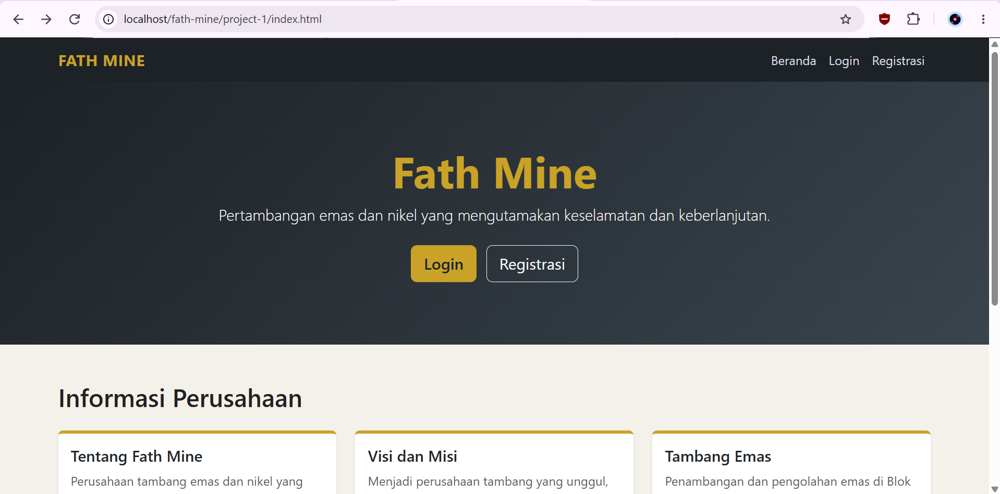
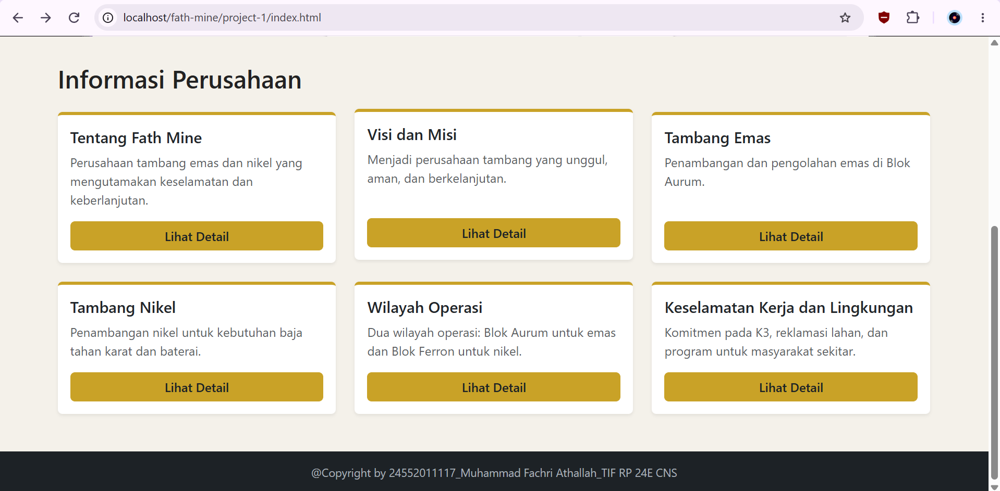

### Halaman Detail Informasi
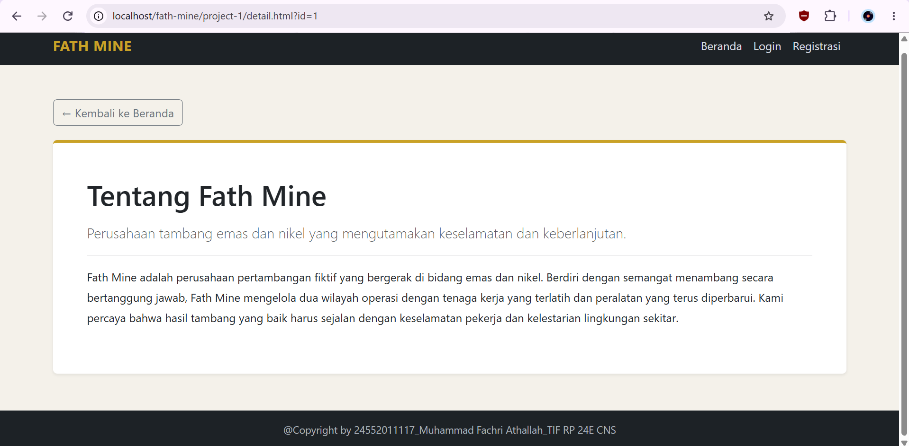

### Halaman Registrasi
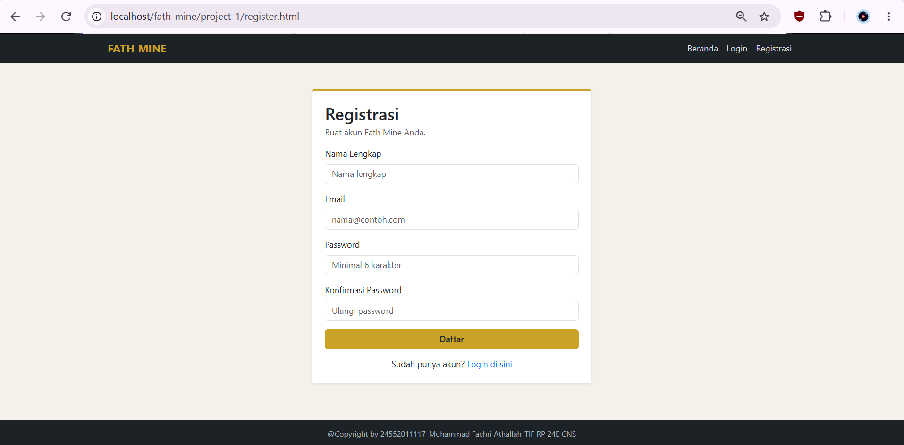

### Halaman Login
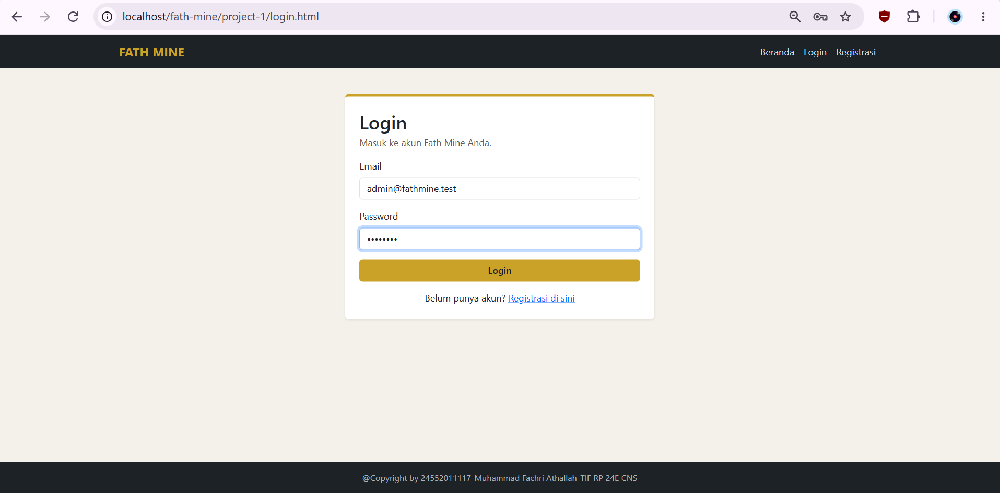

### Halaman Menu Utama
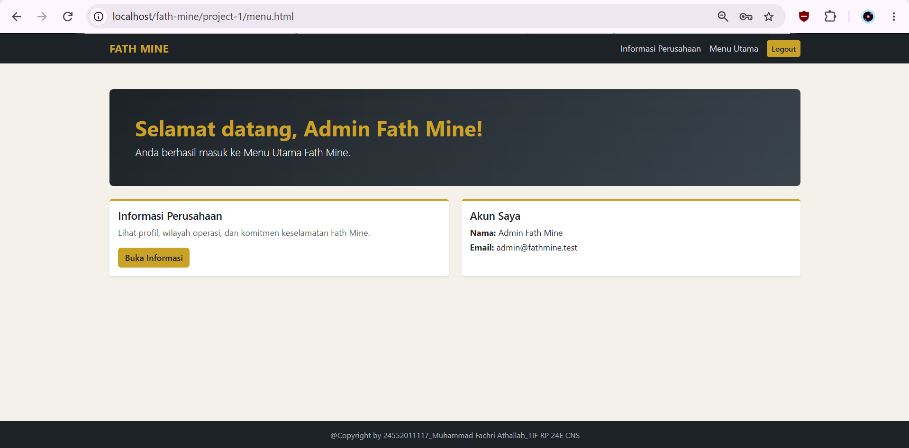

## Hasil Pengujian API (Bruno)

Koleksi pengujian ada di folder `bruno/fath-mine-api`. Cara membukanya: di Bruno pilih Open Collection, lalu arahkan ke folder tersebut.

### 1. Get semua informasi (GET)


### 2. Get informasi berdasarkan ID (GET)
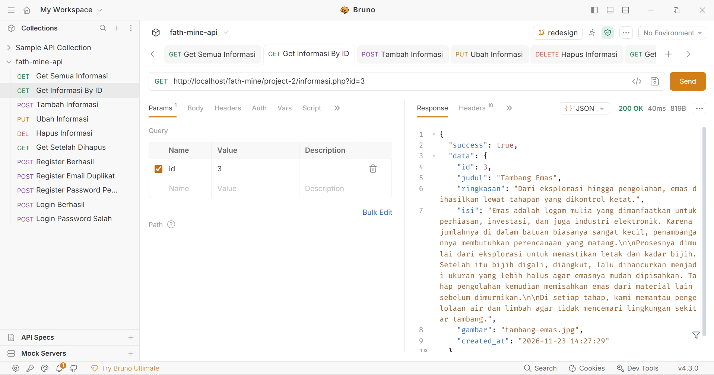

### 3. Tambah informasi (POST)
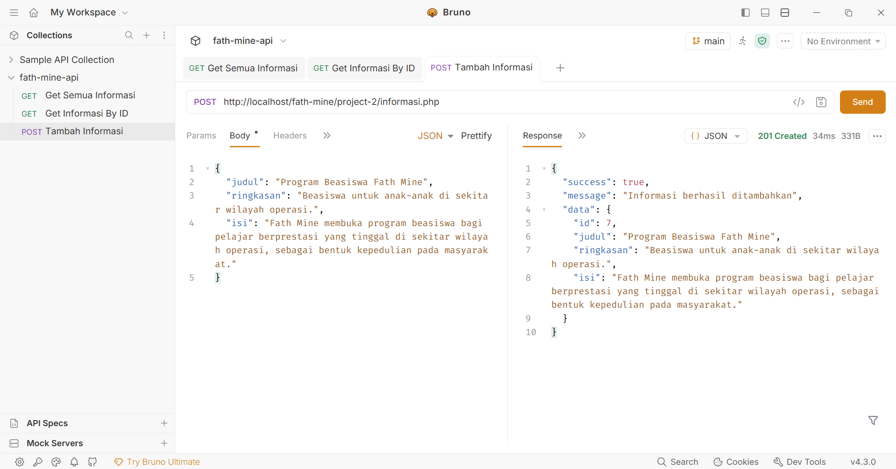

### 4. Ubah informasi (PUT)
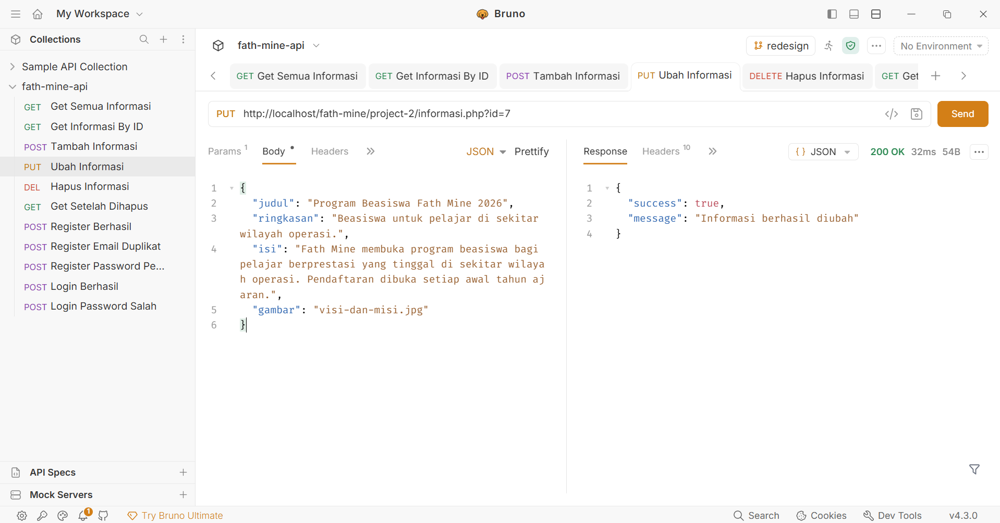

### 5. Hapus informasi (DELETE)
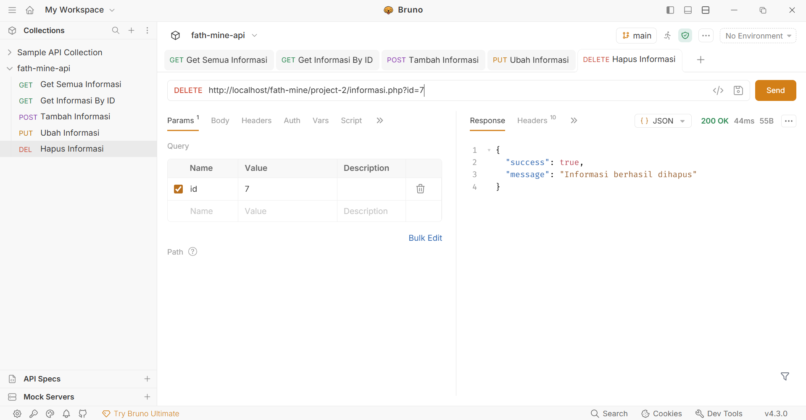

### 6. Get setelah dihapus (hasilnya 404)
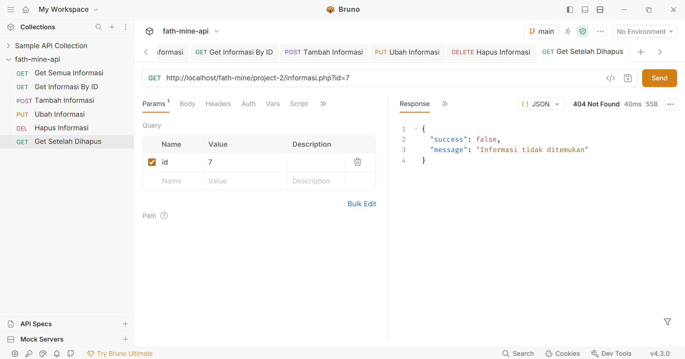

### 7. Registrasi berhasil (POST)
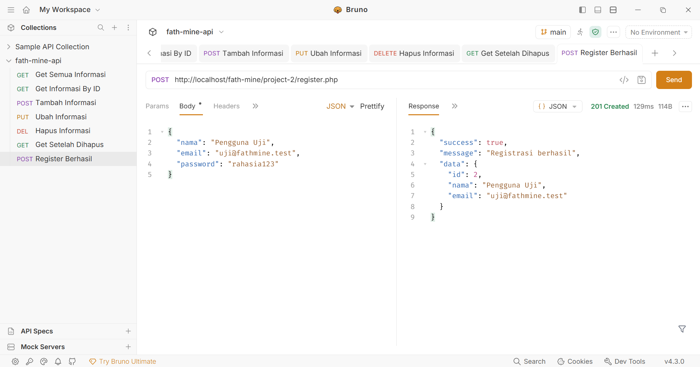

### 8. Registrasi dengan email yang sudah dipakai (hasilnya 409)
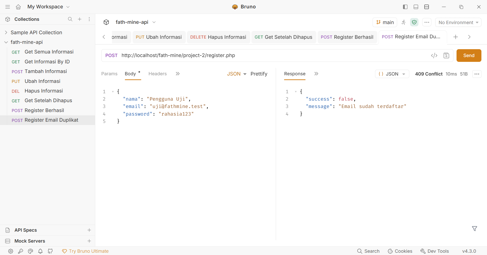

### 9. Registrasi dengan password terlalu pendek (hasilnya 400)
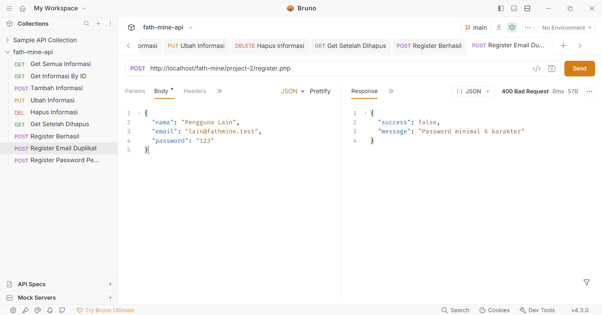

### 10. Login berhasil (POST)
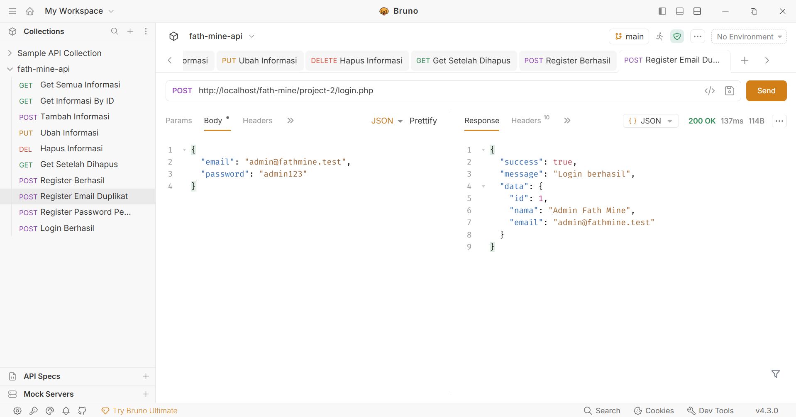

### 11. Login dengan password salah (hasilnya 401)
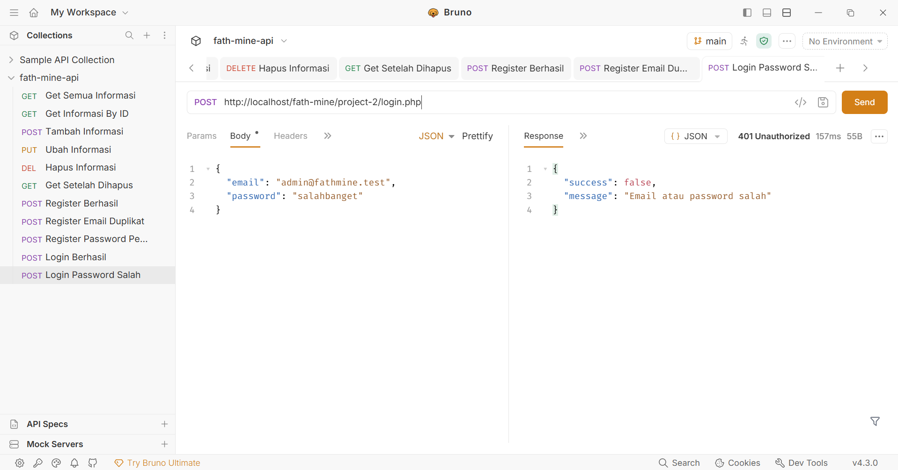